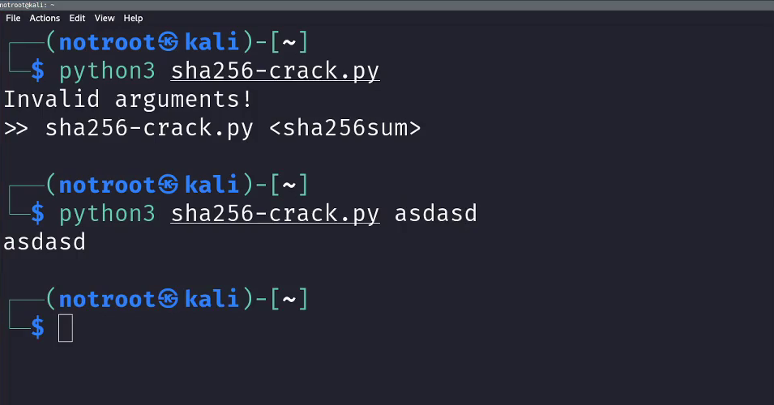
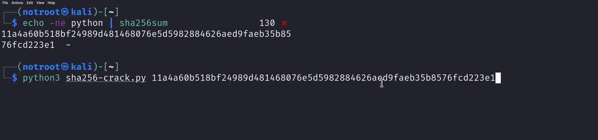
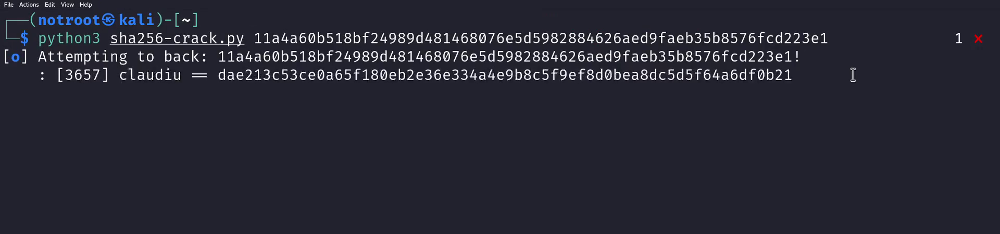
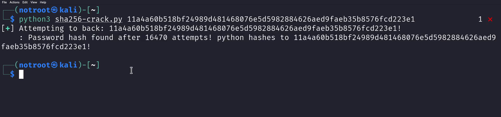

# ⚡ Project #2: SHA-256 Password Cracking (`sha256-crack.py`)
**Author:** Youssef Tamer Dabash (`Dr. Dabash`)

أداة كسر هاشات **SHA-256** بالاعتماد على الهجوم القاموسي (`Dictionary Attack`) باستخدام قائمة **`rockyou.txt`** ومكتبة **`pwntools`**.

---

## ⚙️ فكرة عمل السكريبت
1. استقبال قيمة هاش `SHA-256` المستهدف كمعامل سطر أوامر عبر `sys.argv[1]` والتحقق من صحة عدد المعاملات.
2. فتح واجهة تحديث لحظية في التيرمنال باستخدام `log.progress()` لعرض رقم المحاولة، الكلمة الحالية، والهاش الناتج عنها في نفس السطر.
3. قراءة ملف `rockyou.txt` بترميز `latin-1` لتجنب أخطاء فك الترميز (`UnicodeDecodeError`) مع الرموز الخاصة.
4. حساب هاش SHA-256 لكل كلمة بواسطة دالة `sha256sumhex()` ومقارنتها بالهاش المطلوب حتى التطابق.

---

## 💻 تشغيل السكريبت
```bash
# فحص طريقة الاستخدام
python3 sha256-crack.py

# توليد هاش SHA-256 لكلمة python وتمريره للسكريبت
echo -ne python | sha256sum
python3 sha256-crack.py 11a4a60b518bf24989d481468076e5d5982884626aed9faeb35b8576fcd223e1
```

---

## 📸 لقطات شاشة التنفيذ من التيرمنال (Terminal Screenshots)

### 1. التحقق من معاملات التشغيل (`sys.argv`)


### 2. توليد الهاش التجريبي عبر `sha256sum`


### 3. عملية الفحص اللحظي ومقارنة الهاشات عبر `log.progress`


### 4. النجاح في كسر الهاش والوصول لكلمة المرور (`python`) بعد `16470` محاولة

